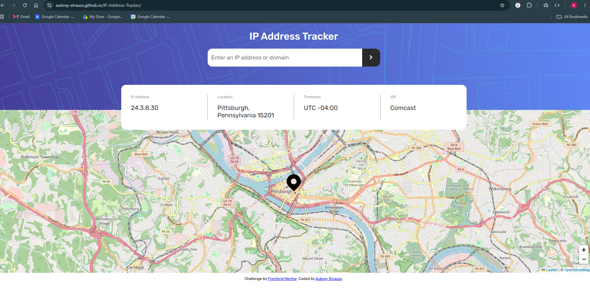
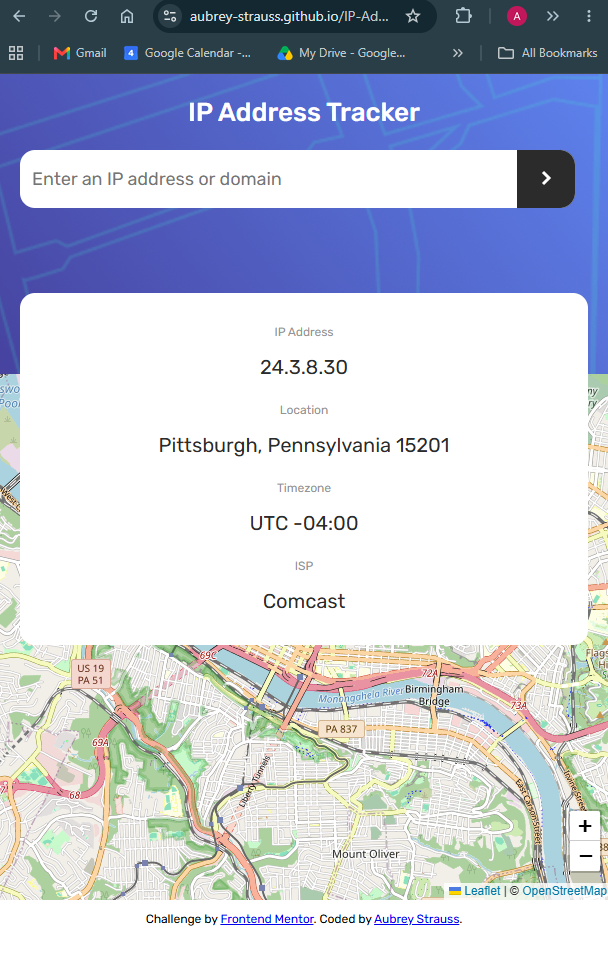

# Frontend Mentor - IP address tracker solution

This is a solution to the [IP address tracker challenge on Frontend Mentor](https://www.frontendmentor.io/challenges/ip-address-tracker-I8-0yYAH0). Frontend Mentor challenges help you improve your coding skills by building realistic projects. 

## Table of contents

- [Overview](#overview)
  - [The challenge](#the-challenge)
  - [Screenshot](#screenshot)
  - [Links](#links)
  - [Project setup](#project-setup)
- [My process](#my-process)
  - [Built with](#built-with)
  - [What I learned](#what-i-learned)
  - [Continued development](#continued-development)
  - [Useful resources](#useful-resources)
  - [AI Collaboration](#ai-collaboration)
- [Author](#author)

## Overview

IP Address Tracker is a web app that shows where an IP address or domain is located. When the page loads, it displays your own IP address, location, timezone, and internet provider, with your location pinned on an interactive map. You can search for any IP address or domain to see the same details and watch the map move to its location. The layout adjusts for desktop and mobile screens.

### The challenge

Users should be able to:

- View the optimal layout for each page depending on their device's screen size
- See hover states for all interactive elements on the page
- See their own IP address on the map on the initial page load
- Search for any IP addresses or domains and see the key information and location

### Screenshot




### Links

- Repository: [github.com/aubrey-strauss/IP-Address-Tracker](https://github.com/aubrey-strauss/IP-Address-Tracker)
- Live site: [aubrey-strauss.github.io/IP-Address-Tracker](https://aubrey-strauss.github.io/IP-Address-Tracker/)


## Project setup

You don't need to install anything to run this project. Here's how I'd get it running:

1. Clone the repo:
   ```
   git clone https://github.com/aubrey-strauss/IP-Address-Tracker.git
   ```
2. Open the project folder in VS Code.
3. Right-click `index.html` and choose **Open with Live Server**.

The page will load your own IP address and location right away. Type any IP address (like `8.8.8.8`) or domain (like `google.com`) in the search bar and press Enter to look it up.

**A note about the API key:** I used a free IPify account, and my API key is in `script.js`. 

## My process

**Planning and setup**
- Created GitHub repo and downloaded Frontend Mentor's starter files.

**HTML**
- Built the page structure before any styling.

**CSS**
- Styled one section at a time, using the Figma design file for precise styling.

**JavaScript**
- Coded the form to notice a search, read what was typed, fetch the data, fill in the card, and move the map and pin.
- Added domain searches, form validation for empty searches, and error handling for bad addresses.

**Throughout**
- Committed after each finished piece.
- Kept a study guide of terms and mistakes as I went.

### Built with

- Semantic HTML5 (header, main, section, form)
- CSS Flexbox and a media query for the mobile layout
- Vanilla JavaScript: fetch, async/await, and try/catch
- [Leaflet](https://leafletjs.com/) for the interactive map
- [OpenStreetMap](https://www.openstreetmap.org/) map tiles
- [IPify IP Geolocation API](https://geo.ipify.org/) for location data
- Figma design file for exact sizes and spacing
- GitHub Pages for deployment


### What I learned

**Layering elements with `position` and `z-index`**

On mobile, the results card pushed the map down and left an empty gap behind it. I learned that elements normally take turns down the page, so the map couldn't start until the card ended. Giving the card `position: absolute` took it out of that order, so the map moved up underneath it, and `z-index` kept the card on top of the map.

```css
main {
  position: relative;
}

.info-container {
  position: absolute;
  top: -81px;
  z-index: 1001;
}
```

That fix caused a new problem: the card now covered the map's zoom buttons. I learned that Leaflet lets you turn off its default controls and place them yourself, so I moved them to the bottom-right corner.

```js
const map = L.map('map', { zoomControl: false });
L.control.zoom({ position: 'bottomright' }).addTo(map);
```


### Continued development

- Using console.log more efficiently.
- Setting up projects cleanly from the start. I lost time fixing nested folders. In, and put backticks around `git rev-parse --show-toplevel` before the first commit.
- Reviewing more before committing. Running `git diff` will help in the future. 


### Useful resources

- [My study guide](./study-guide.md) - Terms, concepts, and mistakes I kept track of while building this project.

- [Frontend Mentor Pro](https://www.frontendmentor.io/pro) - The Figma design file let me match exact sizes, spacing, and colors instead of guessing from the JPG designs.
- [Claude](https://claude.ai) - Explained new terms in plain language, helped me debug, and checked my work as I built each part.
- [Leaflet Quick Start Guide](https://leafletjs.com/examples/quick-start/) - How to add the map, tiles, and markers.
- [IPify API documentation](https://geo.ipify.org/docs) - The request format and what the response contains.
- [MDN Web Docs](https://developer.mozilla.org/) - Reference for HTML, CSS, and JavaScript.


### AI Collaboration

I used Claude as a tutor and debugging partner throughout this project.

**How I used it:** 
- **Learning terms and concepts.** I asked for plain-language explanations of new terms and why they're named what they are (like API, flexbox, async/await, regex, and z-index). Claude also kept a running study guide of everything I learned.
- **Step-by-step guidance.** For most of the HTML and CSS, I got hints and wrote the code myself using the Figma design.
- **Building the JavaScript.** Claude gave me example code for some steps I was confused on, written to connect to my own HTML: the ids and elements I'd already built, like search-form, search-input, and the four result fields. I typed each piece in myself, asked about anything I didn't understand, figured out where each line belonged, and tested every step in the browser Console before moving on.
- **Debugging.** Claude looked at my running page and my GitHub repo to find bugs I couldn't see, such as script.js being in the wrong folder, my files being nested too deep for GitHub Pages, and a stray selector that turned my error message black.

**What worked well:** Getting the "why" behind each line made concepts stick, and having bugs explained (not just fixed) taught me patterns I can spot on my own now.

**What didn't:** Sometimes too much came at once, and I got confused about where code belonged. I prompted to be taught like a beginner and it helped to aleviate the difficulty. I also learned to watch VS Code's autocomplete, which incorrectly changed my code more than once and made it more confusing. 

## Author

- GitHub - [aubrey-strauss](https://github.com/aubrey-strauss)
- LinkedIn - [Aubrey Strauss](https://www.linkedin.com/in/aubreystrauss)


